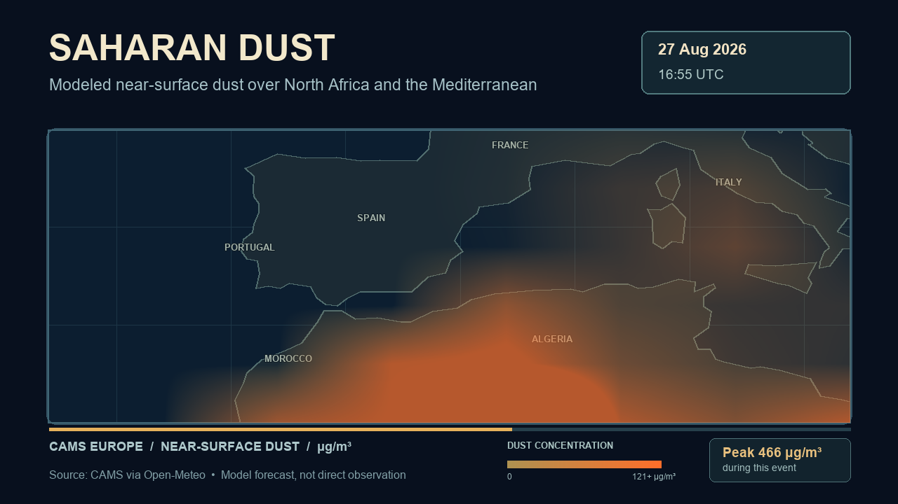

# Saharan Dust

A 20-second atlas animation of modeled near-surface dust over North Africa and
the western Mediterranean. This is the reference project for the 180-day series.



## Reproduce from a fresh checkout

Use Python 3.9 or later and an installed Git client. From the repository root:

```powershell
python -m venv .venv
.venv\Scripts\Activate.ps1
python -m pip install -r requirements.txt
python scripts/validate.py
python engines/dust/render.py --seconds 20 --fps 20
```

On macOS or Linux activate with `source .venv/bin/activate`. The video is written
to `output/001-saharan-dust/saharan-dust.mp4`; it is intentionally ignored by
Git. The source snapshot and Natural Earth map are included so the render does
not depend on a live API. The render uses a deterministic interpolation and
contains no random elements.

To refresh the model snapshot while its rolling archive covers the event:

```powershell
python projects/001-saharan-dust/fetch_data.py --day 2026-08-27
```

Or omit `--day` to find a strong event in the recent 90-day window. A refresh
may differ as Open-Meteo updates its forecast archive. Inspect the new event,
provenance, limitations and thumbnail before updating the manifest.

## Data and interpretation

- **Variable:** `dust`, CAMS European Air Quality Forecast, approximately 10 m
  above ground, in μg/m³. The committed snapshot covers 48 points and 72
  hourly timestamps around 27 August 2026.
- **Provider:** [Copernicus Atmosphere Monitoring Service](https://atmosphere.copernicus.eu/),
  accessed through the [Open-Meteo Air Quality API](https://open-meteo.com/en/docs/air-quality-api).
  The snapshot records its precise request URL and retrieval timestamp.
- **Basemap:** [Natural Earth 1:110m land](https://github.com/nvkelso/natural-earth-vector),
  public domain. Geographic outlines are context, not measurement boundaries.
- **Limitations:** These are modeled forecasts, not direct observations. Values
  near the model-domain boundary and local peaks deserve caution. Bilinear
  interpolation makes the field smooth for display but cannot resolve detail
  smaller than the model grid. The animation traverses 72 model hours in 20
  seconds; it does not represent real-time motion.

The code is MIT licensed. Data and basemap retain their own terms; check source
licenses before redistribution or commercial use.

## Outputs and review

`manifest.json` inventories the data, code, thumbnail, video and attribution.
The [20-second MP4](https://github.com/MattMullin/science-visualizations/releases/download/day-001-saharan-dust/saharan-dust.mp4)
is stored as a GitHub Release asset. `assets/thumbnail.png` is checked in.
The [interactive time explorer](https://mattmullin.github.io/science-visualizations/science/assets/001-saharan-dust/demo/)
is served with the public gallery. The [project source](https://github.com/MattMullin/science-visualizations/tree/main/projects/001-saharan-dust)
includes all reproduction instructions. The ready-to-publish X caption is in
the manifest; posting to X still requires a separate explicit action.

